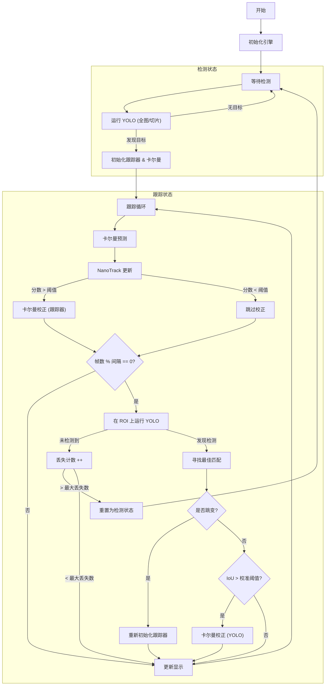

# 混合跟踪器算法综述 (Hybrid Tracker Algorithm Review)

## 节点接口更新（同步 AirSim 最近三次提交）

对应 `airsim_tracker` 提交 `1052e1f`、`ab115d8`、`a6420b2`。
以下描述节点当前接口；后面的旧版算法综述不作为参数默认值依据。

- `/fpv/target_bbox`（`vision_msgs/Detection2D`）和 `/fpv/target_los`
  （`geometry_msgs/TwistStamped`）成对发布，使用相同时间戳。
  bbox 保留 KF 浮点精度，并保持实机原有的图像边界裁剪。
- LOS 的 `header.frame_id = camera_flu`；`twist.linear.y/z` 分别为俯仰角
  （向下正）/偏航角（向左正），单位 rad；`twist.angular.y/z` 为对应角速度，单位 rad/s。
  角速度先将上一帧视线及滤波后的速度旋转到当前相机系，再差分并低通，消除云台自转影响。
  其余分量为零。目标丢失或 OFF 后两条消息的 `frame_id` 均为空；
  缺失/非法相机姿态时只将 LOS 标为无效，保留 bbox。
- 默认 `publish_prediction: false`，bbox/LOS 使用图像采集时刻。
  设为 `true` 时，只有最新 `/fpv/gimbal` 姿态位于采集时刻和当前时刻之间、
  且距当前不超过 0.3 秒，才预测到该姿态的时间戳；否则回退采集时刻。
  重复或倒序的发布时刻会被跳过，避免下游重复处理同一预测。
- `los.rate_filter_tau: 0.12` 是角速度低通时间常数（秒），`0` 关闭低通。
  采样间隙超过 0.3 秒、目标丢失、YOLO 重锚定或重新 ON 都会清零旧角速度。
  相机内参按实际输出分辨率缩放，分别使用 fx/fy，支持非等比缩放。
- 实机默认 `enable_preview: true`：启动后在 `/fpv/tracker_image` 发布原始预览，
  ON 前先完整停止预览线程，再交给跟踪线程发布标注图像；OFF 后恢复预览。
  两者共用相机且始终只有一个队列消费者。预览不录制，也不提前消费视频文件回放。
  跟踪阶段继续由 `visualized_result` 控制图像输出；无人订阅且无需录制时跳过图像转换。
  图像 QoS 为 best-effort、depth 1，订阅端应使用兼容的 best-effort QoS。
- 开启 `need_save` 并触发 ON 后，rosbag 还会录制 `/mavros/imu/data`
  （`sensor_msgs/Imu`）。订阅使用 best-effort、depth 100，保留完整原始消息，
  bag 写入时间使用消息的 `header.stamp`；OFF 关闭 bag 后不再写入。
  该订阅仅用于录制，与 `/fpv/gimbal` 的相机旋转补偿互不影响。
- 云台姿态仍由外部桥接节点通过 `/fpv/gimbal` 提供，跟踪节点不控制云台。
  Orin Nano 的相机采集、VPI、TensorRT 模型和实机检测阈值保持原有配置；
  AirSim 的 RPC/场景配置不适用于实机，未移植。

两个 launch 文件均支持以下参数（原有其他参数继续可用）：

```bash
ros2 launch drone_tracker drone_tracker.launch.py publish_prediction:=false enable_preview:=true los_rate_filter_tau:=0.12
ros2 launch drone_tracker balloon_tracker.launch.py publish_prediction:=true
```

回归测试位于 `tests/test_target_los.cpp`，覆盖相机复合旋转、运动目标、Python 参考值、
KF/LOS 组合、时间戳去重、复位和 ROS 消息配对；测试本身仅依赖主机 OpenCV 和 ROS 消息头，
无需 GPU 或模型。Jetson 上通过项目 CMake/CTest 构建运行：

```bash
colcon build --packages-select drone_tracker --cmake-args -DBUILD_TESTING=ON
colcon test --packages-select drone_tracker --ctest-args -R target_los_tests --output-on-failure
colcon test-result --verbose
```

硬件验收：用 best-effort 订阅 `/fpv/tracker_image`，确认启动即预览；连续执行 ON/OFF/ON，
确认标注与原图切换且录像只覆盖 ON 区间；检查 bbox/LOS 时间戳和上述有效性约定。

## 1. 简介
`HybridTracker` 是一个专为无人机应用设计的鲁棒目标跟踪系统。它结合了三种不同算法的优势，以实现高性能跟踪：
1.  **YOLOv8**: 基于深度学习的目标检测器，用于目标初始化和重识别。
2.  **NanoTrack**: 轻量级、高速的相关滤波跟踪器，用于帧间跟踪。
3.  **卡尔曼滤波器 (Kalman Filter)**: 状态估计器，用于平滑轨迹并在遮挡或跟踪器失效期间预测目标位置。

这种混合方法确保系统能够自主发现目标，高效跟踪，并从跟踪失败中恢复。

## 2. 算法组件

### 2.1. YOLOv8 检测器 (`YoloV8Detector`)
*   **角色**: 负责初始目标检测和周期性重新验证。
*   **特性**:
    *   使用 TensorRT 进行加速推理。
    *   支持“切片 (Tiling)”策略，通过将图像分割成重叠的切片来检测高分辨率图像中的小目标。
    *   支持 ROI (感兴趣区域) 推理，以减少计算负载并专注于跟踪区域。
    *   **召回率放宽 (Recall Relaxation)**: 在特定 ROI 内搜索时（跟踪期间），置信度阈值会降低（乘以 `0.75`），以提高重新检测到被跟踪目标的可能性。

### 2.2. NanoTrack (`NanoTracker`)
*   **角色**: 主要的帧间跟踪器。
*   **特性**:
    *   轻量级神经网络跟踪器（骨干网络 + 头部网络）。
    *   提供跟踪结果的置信度分数。
    *   比每帧运行全图检测更快。

### 2.3. 简单卡尔曼滤波器 (`SimpleKalmanFilter`)
*   **角色**: 状态估计和平滑。
*   **特性**:
    *   基于先前的运动模型预测目标位置。
    *   融合 NanoTrack（或 YOLO）的观测结果来更新状态。
    *   当视觉跟踪器暂时失效时提供预测。

## 3. 工作流描述

跟踪器作为一个状态机运行，主要有两个状态：**检测中 (Detecting)**（未初始化）和 **跟踪中 (Tracking)**（已初始化）。

### 3.1. 初始化阶段
*   系统加载 YOLO 和 NanoTrack 的 TensorRT 引擎。
*   通过 `TrackerSettings` 配置参数。

### 3.2. 检测状态 (未初始化)
当跟踪器未初始化时（启动时或目标丢失后）：
1.  **全帧检测**: 系统在完整图像上运行 YOLOv8。
2.  **切片 (可选)**: 如果启用且未找到目标，则将图像分割成切片以查找更小的目标。
3.  **目标选择**: 如果找到检测结果，则选择置信度最高（或符合特定标准）的目标。
4.  **转换**: 系统使用检测到的框初始化 NanoTrack 和卡尔曼滤波器，并转换到 **跟踪状态**。

### 3.3. 跟踪状态 (已初始化)
在此状态下，系统处理每一帧以更新目标位置：

1.  **预测**: 卡尔曼滤波器基于前一状态预测当前位置。这作为先验估计。
2.  **视觉跟踪**: NanoTrack 在预测位置附近搜索目标。
    *   如果跟踪分数高于 `tracking_conf_threshold`，则认为结果有效。
3.  **校正**:
    *   如果 NanoTrack 成功，其结果用于 **校正** 卡尔曼滤波器状态。
    *   显示框更新为校正后的卡尔曼状态。
4.  **周期性重新验证 (YOLO 检查)**:
    *   每 `yolo_interval` 帧，系统在当前目标周围的裁剪 **ROI** 上运行 YOLOv8。
    *   **ROI 计算**: ROI 是当前框按 `roi_scale_factor` 缩放得到的。
    *   **召回率放宽**: 降低检测阈值以确保在目标存在时能找到它。
5.  **校准与恢复**:
    *   系统将 YOLO 检测结果与当前跟踪器位置进行比较。
    *   **跳变检测**: 如果 YOLO 框显著不同（距离 > `max_position_jump_ratio` * 图像平均尺寸 或尺寸比率 > `max_size_jump_ratio`），则假设跟踪器已漂移或切换了目标。系统使用 YOLO 框 **重新初始化** 跟踪器。
    *   **校准**: 如果 YOLO 框重叠良好（IoU > `iou_calibrate_threshold`），则用于 **校正** 卡尔曼滤波器，防止长期漂移。
6.  **丢失处理**:
    *   如果周期性 YOLO 检查连续多次（`lost_max_count` 次）未能找到目标，系统宣布目标丢失并恢复到 **检测状态**。

## 4. 工作流图



## 5. 参数说明

`HybridTracker` 的行为由 `TrackerSettings` 结构体控制。

| 参数 | 类型 | 默认值 | 描述 |
| :--- | :--- | :--- | :--- |
| `yolo_engine_path` | string | "drone_int8.engine" | YOLOv8 的 TensorRT 引擎文件路径。 |
| `nanotrack_backbone_path` | string | "nanotrackv3_backbone_int8.engine" | NanoTrack 骨干网络引擎路径。 |
| `nanotrack_head_path` | string | "nanotrack_head_int8.engine" | NanoTrack 头部网络引擎路径。 |
| `target_class_id` | int | 0 | YOLO 应查找的类别 ID。 |
| `tracking_conf_threshold` | float | 0.8 | NanoTrack 结果被认为对卡尔曼校正有效的最低分数。 |
| `yolo_conf_threshold` | float | 0.45 | 全帧搜索期间 YOLO 检测的置信度阈值。 |
| `yolo_nms_threshold` | float | 0.45 | YOLO 合并重叠框的非极大值抑制 (NMS) 阈值。 |
| `yolo_interval` | int | 3 | 周期性 YOLO 检查的频率（每 N 帧）。越低越鲁棒但越慢。 |
| `yolo_recall_relax_ratio` | float | 0.75 | 运行 ROI 检测时 `yolo_conf_threshold` 的乘数。实际上将阈值降低以提高召回率。 |
| `iou_calibrate_threshold` | float | 0.6 | 触发使用 YOLO 框进行卡尔曼校正所需的跟踪器框与 YOLO 框之间的最小 IoU。 |
| `max_position_jump_ratio` | float | 0.25 | 当前框与 YOLO 框之间允许的最大位置跳变比率（相对于图像平均尺寸）。超过此值触发“跳变”（重新初始化）。 |
| `max_size_jump_ratio` | float | 2.0 | 允许的最大尺寸变化比率。超过此值触发“跳变”。 |
| `lost_max_count` | int | 50 | 目标被认为丢失前，连续 YOLO 检查失败的最大次数。 |
| `roi_scale_factor` | float | 2.0 | 周期性 YOLO 检查中使用的感兴趣区域 (ROI) 的缩放因子。ROI 宽度 = `box.width * 2.0`。 |

## 6. 关键逻辑细节

### 框跳变检测 (Box Jump Detection)
用于检测跟踪器是否漂移到背景，或者检测器是否在远处发现了更好的目标。
```cpp
bool pos_jump = distance > max_position_jump_ratio * (img_w + img_h) / 2;
bool size_jump = (size_ratio > max_size_ratio || size_ratio < 1.0/max_size_ratio);
if (pos_jump || size_jump) -> 重新初始化 (Re-initialize)
```

### 校准策略 (Calibration Strategy)
如果跟踪器工作良好（与检测器的 IoU 高），我们稍微更信任检测器来校正任何缓慢的漂移。
```cpp
if (iou > iou_calibrate_threshold) -> 使用 YOLO 框进行卡尔曼校正
```
这使跟踪器保持“锚定”在检测器看到的真实物体外观上。

### ROI 计算 (ROI Calculation)
为了加速检测并减少背景误报，YOLO 在裁剪图像上运行：
```cpp
roi_w = box.width * roi_scale_factor;
roi_h = box.height * roi_scale_factor;
// 限制在图像边界内
```
这对于在 Jetson 等嵌入式设备上保持实时性能至关重要。
